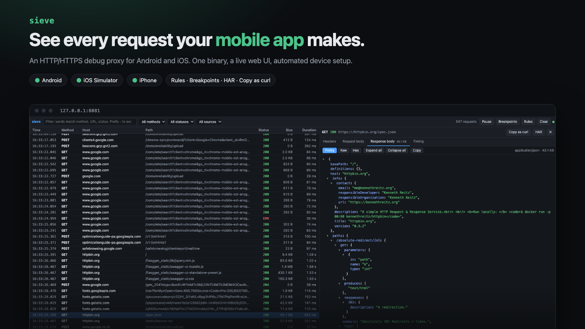

# sieve



An HTTP/HTTPS debug proxy for Android and iOS, written in Rust.

sieve runs on your Mac, intercepts TLS with its own root CA, and shows every request in a live web UI. Device setup is automated wherever the platform allows, so you can inspect a debug app on an emulator, Simulator, or phone without changing its code.

> **Status: pre-alpha.** Features are implemented and covered by automated tests, but device setup has not yet been verified end to end on real hardware. See [docs/PLAN.md](docs/PLAN.md) for the roadmap and [docs/TESTING.md](docs/TESTING.md) for the manual test guide.

## Features

- **MITM proxy:** HTTP/1.1, HTTP/2, and WebSocket, with gzip/br/zstd decoding for display.
- **Live web UI:** virtualized flow table, filters, JSON tree view, copy as curl, and HAR export.
- **Rules:** rewrite headers, body, or status; mock responses; map remote hosts; add delays; block requests.
- **Breakpoints:** pause a request, edit it in the UI, then continue or abort.
- **Scripting:** custom request handling with [Rhai](https://rhai.rs) scripts.
- **One-command device setup:** Android (proxy, system CA, VPN), iOS Simulator, and physical iPhone.
- **Certificate-pinning bypass** on Android via Frida, for apps you own or are authorized to test.
- **Safe cleanup:** teardown and `sieve doctor` restore any proxy settings sieve changed.
- **Single binary:** the web UI is embedded.

## Installation

### Prebuilt binary

Download the archive for your platform from [Releases](https://github.com/saamodra/sieve/releases), then:

```sh
tar xzf sieve-*.tar.gz
sudo mv sieve-*/sieve /usr/local/bin/
```

On macOS, if a browser download gets blocked by Gatekeeper, run `xattr -d com.apple.quarantine /usr/local/bin/sieve`.

### From source

Requirements: Rust 1.90+ and Node.js (for the web UI).

```sh
git clone https://github.com/saamodra/sieve.git
cd sieve
(cd ui && npm ci && npm run build)   # build the UI first so it gets embedded
cargo install --path crates/sieve
```

This installs `sieve` into `~/.cargo/bin`, which rustup adds to your `PATH`. Check it with `sieve --help`. To update, pull and run both build commands again.

## Quick start

```sh
sieve start
```

| Service | Default address         |
| ------- | ----------------------- |
| Proxy   | `127.0.0.1:8730`        |
| Web UI  | `http://localhost:8731` |

Check that it works:

```sh
sieve ca export --format pem -o sieve-ca.pem
curl -x http://127.0.0.1:8730 --cacert sieve-ca.pem https://example.com
```

Useful flags for `sieve start`:

| Flag                  | Purpose                                         |
| --------------------- | ----------------------------------------------- |
| `--listen`            | Proxy address                                   |
| `--ui-listen`         | Web UI address                                  |
| `--passthrough HOST`  | Tunnel a host without intercepting it           |
| `--upstream-ca PEM`   | Trust an extra root CA for upstream servers     |
| `--max-body-bytes N`  | Body size limit per flow (default 5 MiB)        |

## Device setup

| Platform                     | Command                    | Notes                                              |
| ---------------------------- | -------------------------- | -------------------------------------------------- |
| Android, no root             | `sieve android setup`      | Uses `adb reverse` and `http_proxy`                |
| Android, emulator or rooted  | `sieve android inject-ca`  | Installs the CA into the system store              |
| Android, apps that ignore the proxy | `sieve android vpn` | Needs the [companion app](android-vpn/README.md)  |
| Android, pinned apps         | `sieve android frida`      | See [docs/frida.md](docs/frida.md)                 |
| iOS Simulator (macOS)        | `sieve ios-sim setup`      | See [docs/ios-simulator.md](docs/ios-simulator.md) |
| iPhone                       | `sieve ios-device setup`   | Scan the QR code on the same Wi-Fi network         |

Run `sieve <command> --help` for all options.

### Android

```sh
sieve android setup       # route the device through sieve
sieve android teardown    # undo when done
```

Install the CA from `/sdcard/Download/sieve-ca.crt` via **Settings → Security → Install certificate**. Apps targeting Android 7+ ignore user CAs by default. For your own debug build, `sieve android nsc` prints the `network_security_config.xml` snippet you need.

`inject-ca` requires a **Google APIs** emulator image (not Google Play) or a rooted device. It does not survive a reboot.

### iOS Simulator

`sieve ios-sim setup` trusts the CA in every booted Simulator and sets the Mac's system proxy. Only Simulator traffic is intercepted; other Mac apps are tunneled untouched (pass `--intercept-mac` to intercept them too). `sieve ios-sim teardown` restores your previous settings.

### iPhone

1. Run `sieve ios-device setup` and scan the QR code.
2. Install the profile, then enable it under **Settings → General → About → Certificate Trust Settings**.
3. Set the Wi-Fi proxy to **Automatic** with the PAC URL shown on the setup page.

The setup page shows a green check once HTTPS traffic arrives.

## Rules and scripts

Rules live in `rules.toml` (or `rules.json`) in the config directory. sieve watches the file, so edits apply right away. You can also edit rules from the web UI. Rhai scripts go in the `scripts/` subdirectory. `sieve ca path` prints the CA file paths, which are in the same directory.

## Cleanup

Teardown commands and Ctrl+C restore everything sieve changed. If a session crashed:

```sh
sieve doctor             # list leftover state
sieve doctor --restore   # restore the Mac proxy and Android http_proxy
```

<details>
<summary>Manual reset</summary>

Android:

```sh
adb shell settings put global http_proxy :0
adb reverse --remove-all   # removes all reverse rules
```

macOS system proxy:

```sh
networksetup -listallnetworkservices
networksetup -setwebproxystate "Wi-Fi" off
networksetup -setsecurewebproxystate "Wi-Fi" off
```

</details>

## Troubleshooting

| Problem                                   | Fix                                                                         |
| ----------------------------------------- | --------------------------------------------------------------------------- |
| iPhone profile installed but HTTPS fails  | Enable it in **Certificate Trust Settings**                                 |
| Android has no internet after a session   | `sieve doctor --restore`, or clear `http_proxy` (see above)                 |
| `adb root` fails on the emulator          | Use a Google APIs image, not Google Play                                    |
| TLS handshake fails for a host            | Usually certificate pinning. Use `sieve android frida` or `--passthrough`   |
| App traffic is missing entirely           | It may use HTTP/3 (block UDP 443) or ignore the proxy (use VPN mode)        |
| Flutter app traffic is missing            | Flutter ignores the system proxy. See [docs/frida.md](docs/frida.md)        |

## Responsible use

Use sieve only on apps and devices you own or are explicitly authorized to test. Anyone with the CA private key can read the HTTPS traffic of devices that trust it. Keep the key private, and run `sieve ca regenerate` if it may have been exposed.

## Contributing

See [AGENTS.md](AGENTS.md) for the project layout and conventions. Before opening a PR, run:

```sh
cargo fmt --all --check
cargo clippy --workspace --all-targets -- -D warnings
cargo test --workspace
```
